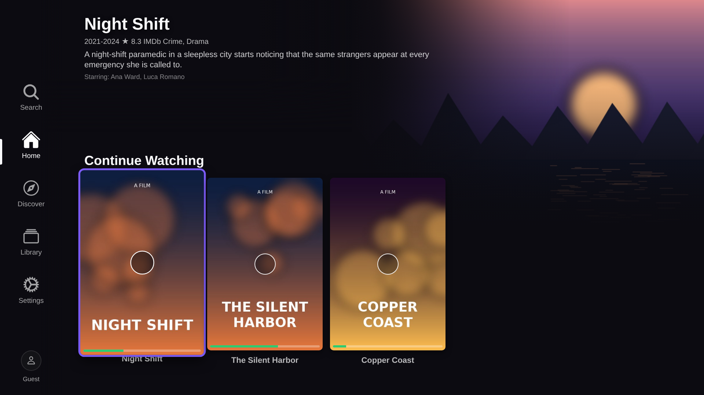
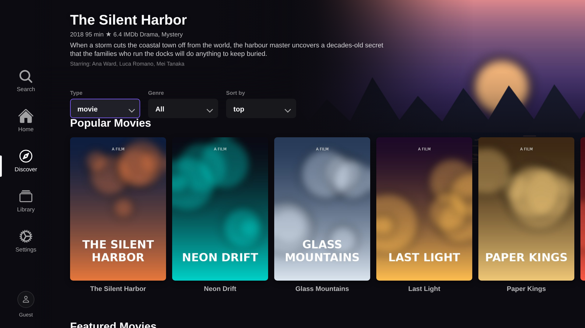
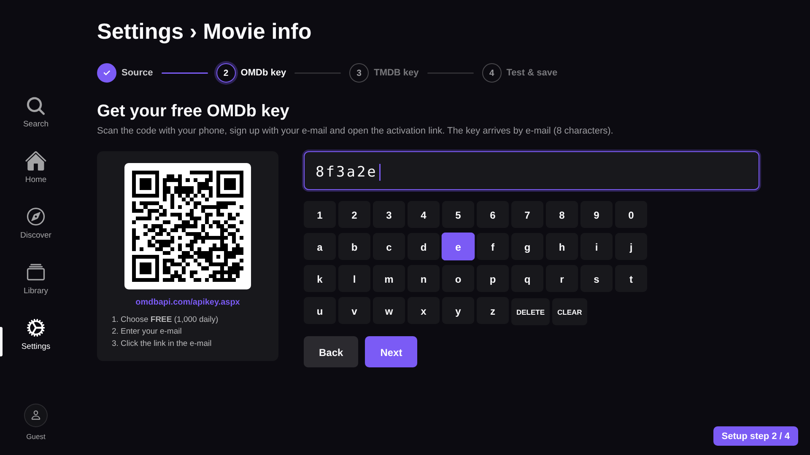

# Streamio port (Samsung 2017 TV)

A Stremio client for **Samsung Tizen 3.0 TVs (2017 models, e.g. UE50MU6102)**, rebuilt to look and behave like the Stremio Android TV app — and to stream torrents **100% on the TV**, with no PC, phone or Node.js server running next to it.

> Unofficial fan project. Not affiliated with or endorsed by Stremio.



## What's inside

| Folder | What it is |
| --- | --- |
| `app-native/` | **Stremio Native** — the main app (Tizen web widget, Chromium 47 / ES5) with a built-in torrent engine |
| `app-native/nacl/src/` | The on-device torrent engine (C++, PNaCl/NaCl): BitTorrent wire protocol, UDP trackers, DHT (BEP 5), and an HTTP range server on `127.0.0.1:11470` |
| `tools/` | `deploy.sh` (build → sign → install → launch), TV log receiver, local peer test |
| `docs/` | Install and native-build notes |

## Features

- **Torrent streaming on the TV**: piece prioritisation and request depth modelled on Android's torrent-stream, threaded handshakes, peer discovery via trackers + DHT, season-pack file selection, background pre-load of the next episode.
- **Playback**: browser `<video>` first, Samsung **AVPlay** for MKV / HEVC / x265 / EAC3; resume, seek spinner with buffer %, "Next episode" button, auto-mark as watched.
- **Stremio account & addons**: sign-in, library and Continue Watching sync, any addon catalogs, subtitles loaded automatically from your subtitle addons.
- **Android TV–style UI**: Home / Discover (Type, Genre and Sort filters) / Library / Search with an on-screen keyboard, per-shelf page indicator, show pages with season tabs and episode lists.
- **Optional extra movie info**: Rotten Tomatoes, Metascore, age rating and box office (OMDb), plus tagline, budget and TMDB score (TMDB). You add your own free keys in *Settings → Movie info* (step-by-step setup with QR codes).

| Discover | Extra info setup |
| --- | --- |
|  |  |

## Install on the TV

Requirements: TV in **Developer Mode** (pointing at your computer's IP), [Tizen Studio](https://developer.samsung.com/smarttv/develop/getting-started/setting-up-sdk/installing-tv-sdk.html) with a Samsung certificate profile, and — to rebuild the engine — the NaCl SDK (`pepper_63`) in `nacl-toolchain/`.

```bash
TV_IP=192.168.0.235 bash tools/deploy.sh
```

`deploy.sh` builds the PNaCl engine, translates it for ARM and x86, packages the widget with the `tvLauncher` certificate profile, installs it and launches it. The prebuilt `.nexe` engine binaries are included, so you can also package `app-native/` directly with Tizen Studio. See [`docs/NATIVE_BUILD.md`](docs/NATIVE_BUILD.md) and [`docs/INSTALL.md`](docs/INSTALL.md).

## Notes

- Target platform: Tizen 3.0, Chromium M47 — the code is plain ES5 (no CSS variables, no modern JS).
- Content availability depends entirely on the addons you install.

## Credits

- UI icons: [Stremio icons](https://github.com/Stremio/stremio-icons) (MIT).
- Font: [Plus Jakarta Sans](https://github.com/tokotype/PlusJakartaSans) (SIL Open Font License).
- Stremio is a trademark of its respective owners; this project is an independent, unofficial port.
